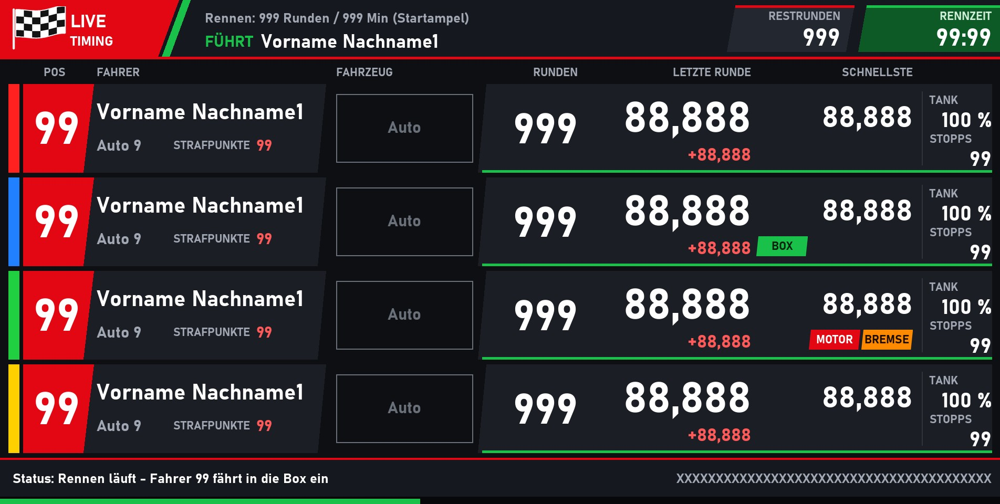

# Rennbildschirm-Designer für Cockpit-XP

Ein Skill für **Claude Code**, mit dem du dir einen **eigenen Rennbildschirm** für die Slotcar-Software
**Cockpit-XP** bauen lässt. Du brauchst keine Programmierkenntnisse: Claude stellt dir der Reihe nach ein paar
einfache Fragen und baut daraus den fertigen Bildschirm, mit Hintergrundbild, `Rennen.xml` und Vorschau.



*Beispiel: 4 Fahrer, digital mit CU30352, Tanken und Schadens-Addon, sportlich in Rot/Grün. Die Vorschau zeigt die
Platzhalter, in Cockpit stehen dort die Live-Werte.*

---

## Was du brauchst

- **Windows** mit installiertem **Cockpit-XP**
- **Claude Code**, als Desktop-App oder im Terminal (ein Claude-Konto ist nötig)
- **Python 3 mit Pillow**. Fehlt es, bietet Claude die Installation an und installiert erst nach deinem OK.
  Ohne Python baut Claude das Bild mit Windows-Bordmitteln (PowerShell).

## Installation

1. Den Ordner `rennbildschirm-designer` (mit der Datei `SKILL.md`) hierhin kopieren:
   ```
   %USERPROFILE%\.claude\skills\rennbildschirm-designer\SKILL.md
   ```
   Also z. B. `C:\Users\<DeinName>\.claude\skills\rennbildschirm-designer\SKILL.md`.
2. Claude Code starten (bzw. neu starten).
3. Schreiben: **„Bau mir einen Rennbildschirm“** oder `/rennbildschirm-designer`.

## So läuft es ab

Claude fragt immer **einen Schritt nach dem anderen**. Meist klickst du nur eine Antwort an.

| Schritt | Frage | Beispiel |
|---|---|---|
| 1 | **Digital oder analog?** Bei digital zusätzlich: Carrera CU30352? Boxengasse/Tanken? „Regler 3“ oder „Auto 3“? | Digital, CU30352, mit Tanken |
| 2 | **Wie viele Fahrer (1–8)?** | 4 Fahrer |
| 3 | **Art des Bildschirms** (Rennen, Training/Quali, Serien-/Clubrennen, Einzelzeitfahren) und **welche Werte**. Der Grundstock (Platz, Name, Runden, letzte und schnellste Runde) ist vorgegeben, du streichst oder ergänzt. Claude fragt auch, ob deine Bahn Messstellen für Sektoren/Topspeed hat und ob du das Schadens-Addon nutzt. | Rennen, dazu Fahrzeugbild, ± zur Vorrunde, Tank %, Stopps, Box-Symbol, Strafpunkte, Schadenssymbole |
| 4 | **Wie soll es aussehen?** Freie Beschreibung: Farben, hell/dunkel, Stil, Vereinslogo. Wer keine Idee hat, bekommt zwei bis drei Skizzen zur Auswahl. Danach: **Standard-Startampel oder eigene?** | „Sportlich, Rot und Grün, eine kleine Zielflagge als Logo“, dunkel, Standard-Ampel |
| 5 | **Wo speichern und wie soll er heißen?** | `…\RennBildschirm\Anwender\RG-4S-Rennen 1920x1080` |

Danach zeigt Claude eine **Zusammenfassung**. Erst nach deinem **„Ja, bauen“** wird gebaut. Claude prüft das Ergebnis
selbst (Vorschau ansehen, XML prüfen, Überlappungen korrigieren) und übergibt es dir mit einer Testanleitung.

Der ganze Ablauf dauert erfahrungsgemäß etwa 10–15 Minuten.

## Was du bekommst

Einen Ordner unter `C:\ProgramData\Cockpit-V2\RennBildschirm\…` mit:

| Datei | Inhalt |
|---|---|
| `Rennen.xml` | Positionen, Schriften und Farben aller Live-Werte |
| `Hintergrund_1904x960.jpg` | Das Hintergrundbild (Full HD mit Taskleiste) |
| `vorschau.jpg` | Vorschau mit Platzhaltern |
| `version.xml` | Version und Entwickler |
| `symbol-*.png` | Eigene Symbole (z. B. Box, Motor, Bremse), falls gewählt |
| `erzeuge_rennbildschirm.py` | Das Skript, das alles erzeugt. Damit sind spätere Änderungen schnell gemacht. |

## Testen in Cockpit

1. Cockpit starten → **Bildschirmauswahl** → den neuen Bildschirm wählen.
2. Nach jeder Änderung den Bildschirm **neu auswählen** oder Cockpit neu starten.
3. Ohne Bahn testen: mit der **Tastensimulation** (F2 zeigt die Tasten) ein Rennen durchspielen.
4. In der Bildschirmauswahl einstellen, ob die Zeilen **nach Platz** wechseln oder **fest nach Spur/Regler** stehen.
5. Passt etwas nicht, einen **Screenshot aus dem laufenden Rennen** an Claude geben und sagen, was geändert werden soll.

Kleinigkeiten kannst du auch im **RBS-Editor** von Cockpit selbst verschieben. Wird das Skript danach erneut
ausgeführt, sind diese Handarbeiten aber weg.

## Gut zu wissen

- **Es wird nichts Bestehendes verändert.** Der Programmordner, `Cp Defaults` und andere Rennbildschirme werden nur
  gelesen. Geschrieben wird nur in den Ordner, den du nennst. Ist er schon belegt, fragt Claude vorher nach.
- **Das Design gehört dir.** Der Skill kopiert keine mitgelieferten Cockpit-Screens und keine fremden Logos.
  Logos und Fotos nur verwenden, wenn du die Rechte daran hast.
- **Schriften:** Für Bildschirme, die weitergegeben werden, nur Schriften nutzen, die auf jedem Windows-PC vorhanden
  sind (z. B. Bahnschrift, Impact, Arial). Bahnschrift und Impact sind genau vermessen, bei anderen Schriften kann
  nach dem ersten Test etwas Nachjustieren nötig sein.
- **Messtechnik:** Sektoren, Zwischenzeiten und Topspeed nur auswählen, wenn die Bahn passende Messstellen hat,
  sonst zeigt Cockpit dort `0,000`.
- **Podium-, Sieger- und Stand-Popups** baut der Skill nicht, die nimmt Cockpit automatisch aus `Cp Defaults`.
- Den Bildschirm-Namen bitte **nicht mit `Cp-` beginnen**. Dieses Präfix ist für die mitgelieferten Screens reserviert.

## Rückmeldung

Fehler, Wünsche oder gelungene Bildschirme gern als **Issue** hier im Repository melden. Am besten mit Screenshot
aus Cockpit und einer kurzen Beschreibung (digital/analog, Fahreranzahl, gewählte Werte).
